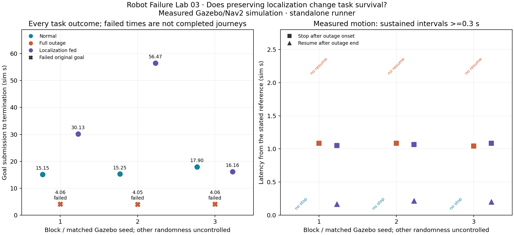
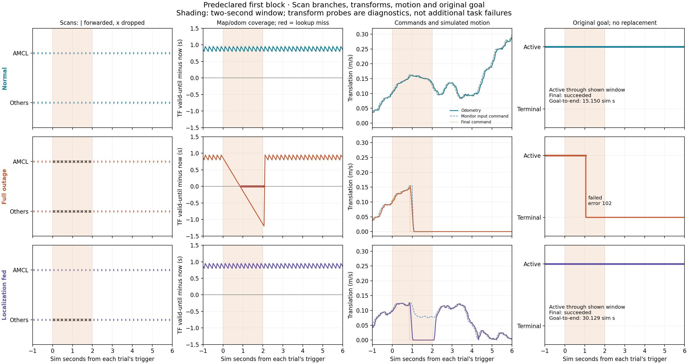

# Robot Failure Lab 03: keeping localization fed during a scan outage

Measured standalone Gazebo/Nav2 simulation. No Vektor integration or physical validation.

## Every planned trial

| Block | Condition | Original goal outcome | Termination time (sim s) | Error | Stop after onset (s) | Resume after window (s) | Drops: localization / obstacles | Recoveries |
| --- | --- | --- | --- | --- | --- | --- | --- | --- |
| 1 | Normal | succeeded | 15.150 | 0 | — | — | 0 / 0 | 0 |
| 1 | Full outage | failed | 4.065 | 102 | 1.086 | — | 10 / 10 | 0 |
| 1 | Localization fed | succeeded | 30.129 | 0 | 1.050 | 0.166 | 0 / 10 | 3 |
| 2 | Full outage | failed | 4.050 | 102 | 1.086 | — | 10 / 10 | 0 |
| 2 | Localization fed | succeeded | 56.469 | 0 | 1.065 | 0.217 | 0 / 10 | 5 |
| 2 | Normal | succeeded | 15.255 | 0 | — | — | 0 / 0 | 0 |
| 3 | Localization fed | succeeded | 16.164 | 0 | 1.086 | 0.202 | 0 / 10 | 0 |
| 3 | Normal | succeeded | 17.904 | 0 | — | — | 0 / 0 | 0 |
| 3 | Full outage | failed | 4.056 | 102 | 1.044 | — | 10 / 10 | 0 |

A failed task terminating early did not complete the route faster. A dash is no qualifying event, not zero latency. Resume is only defined after a measured stop.

## Condition summaries

- Normal: 3/3 original goals succeeded; 0/3 stopped in the window; 0/3 showed post-window resumption after a stop.
- Full outage: 0/3 original goals succeeded; 3/3 stopped in the window; 0/3 showed post-window resumption after a stop.
- Localization fed: 3/3 original goals succeeded; 3/3 stopped in the window; 3/3 showed post-window resumption after a stop.

## Transform diagnostics

Zero-duration probes ask whether map/odom and map/base transforms can be looked up at the current simulated time. These are diagnostic samples, not independent navigation failures. Map/base may miss between odometry callbacks. AMCL map/odom headers are future-dated; their timestamp minus current time measures remaining time coverage, not pose accuracy.

| Trial | Window map/odom unavailable / probes | Tail map/odom unavailable / probes | Original goal at end of outage |
| --- | --- | --- | --- |
| block-1-normal | 0 / 40 | 0 / 80 | active |
| block-1-full-outage | 22 / 40 | 2 / 80 | failed |
| block-1-localization-fed | 0 / 40 | 0 / 80 | active |
| block-2-full-outage-attempt-2 | 22 / 40 | 2 / 80 | failed |
| block-2-localization-fed | 0 / 40 | 0 / 80 | active |
| block-2-normal | 0 / 40 | 0 / 80 | active |
| block-3-localization-fed | 0 / 40 | 0 / 80 | active |
| block-3-normal | 0 / 40 | 0 / 80 | active |
| block-3-full-outage | 22 / 40 | 2 / 80 | failed |

## Method, evidence and limits

- Three main blocks, Gazebo seeds 101/102/103. Orders normal/full/localization-fed, full/localization-fed/normal, localization-fed/normal/full. Three excluded verification trials precede the main series; all attempts are retained separately.
- Fresh simulation/Nav2 for each trial; equal 1.5-sim-second pre-goal wait. The same two scan branches and all navigation parameters are used in every condition. Full outage gates both branches; localization-fed gates only the branch for both costmaps and collision monitor.
- Trigger after >=3 sim seconds and translation >=0.05 m/s sustained >=0.3 s with fresh odometry. Drop newly received scans for two simulated seconds; no buffering, replay, or acquisition timestamp rewriting. Collision monitor remains enabled with unchanged one-second source timeout.
- Stop: odometry translation <=0.01 m/s and |yaw rate| <=0.03 rad/s for >=0.3 s, with <=0.15-s sample gaps. Resume: translation >=0.05 m/s for >=0.3 s after the window, following a measured stop. Report interval-start times after confirming duration.
- Observe through at least four simulated seconds after the outage, even after an action abort; continue active tasks to terminal result or 90-sim/270-wall-second task limit. No replacement goal, reset or altered transform timeout. Startup limit 60 wall seconds; infrastructure errors remain separate from task outcomes.
- All records are revalidated scan by scan for gate policy, upstream continuity, acquisition age, branch receipt, prompt restoration, routing, motion sampling and recomputed metrics. Independent observer receipt is not proof each Nav2 consumer processed every scan. Source hashes, frozen parameters and versions are retained.
- AMCL randomness, host scheduling, exact paths and trigger positions remain uncontrolled. Matching Gazebo seeds does not make trajectories deterministic. Odometry is simulated feedback, not independent physical ground truth. Three runs per condition on one static route do not establish a population failure rate, physical safety or general Nav2 reliability.
- The contrast changes AMCL input availability under the remaining outage. It does not separately isolate both costmaps and collision monitor, establish a production remedy for a failed scanner, resolve Lab01 scan-delay uncertainty, or evaluate Vektor. Publication/outbound messages have not occurred.

## Retained startup and teardown anomalies

1 main startup attempt timed out before readiness/goal submission. It was retained and retried in a new directory after a fresh ROS domain; completed outcomes were never rerun. Collision-monitor exit code -11 occurred during post-observation teardown in 2 main trials. All such process-death log entries followed the shutdown signal. See FINDINGS.md and ATTEMPT-AUDIT.json; these anomalies are not included as measured robot-task failures.
